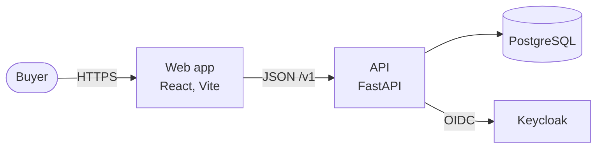

# Documentation (DOC)

What documentation a repo has, where it lives, and how it is written. Structure follows Diátaxis, prose follows Google's developer documentation style guide, decisions are recorded as MADR files, and architecture diagrams use C4 levels.

## Rules

### DOC-001 · MUST · Organize docs by Diátaxis type

```text
docs/
├── tutorials/     # learning-oriented: a lesson that gets a newcomer to a result
├── how-to/        # task-oriented: steps to solve one problem
├── reference/     # information-oriented: API, config, CLI, generated docs
├── explanation/   # understanding-oriented: concepts, architecture, trade-offs
├── adr/           # decision records (DOC-003)
└── runbooks/      # one per alert (OBS-004)
```

- **Why:** Each type serves a different reader need. Mixing them produces pages that teach badly and are hard to look things up in.
- **Check:** Advisory. A CI check can verify that the folders exist.

### DOC-002 · MUST · Give the README the required sections

The README has: what the project is and why it exists, a quickstart of 5 commands or fewer, configuration, development setup, and links to the docs.

- **Why:** The README is the first thing people and agents read. A short quickstart is the fastest proof the project works.
- **Check:** CI checks that the README contains the required headings.

### DOC-003 · MUST · Record hard-to-reverse decisions as ADRs in MADR format

Decisions that are expensive to change (framework, database, auth provider, deploy target, public API shape) get an ADR in `docs/adr/NNNN-slug.md` using the MADR template: context and problem, decision drivers, considered options, decision outcome, consequences.

- **Why:** ADRs keep the reasons for a decision next to the code, so later readers don't repeat the debate or undo it by accident.
- **Check:** Advisory. `plan.md` links the ADRs its design depends on; review checks that new dependencies or infrastructure have one. When to write an ADR, its lifecycle and the decision log are in [decisions.md](decisions.md) (`ADR`).

### DOC-004 · MUST · Document public functions and modules with an example

Public functions, classes and modules have TSDoc comments (TypeScript) or Google-style docstrings (Python, `STY-003`) that include a short usage example.

- **Why:** Reference docs are generated from these comments, and an example answers most questions faster than prose.
- **Check:** Python: ruff `D` rules. TypeScript: advisory. Examples: advisory.

### DOC-005 · MUST · Generate the changelog from commits in Keep a Changelog sections

`CHANGELOG.md` is generated from Conventional Commits by a release tool (release-please, or changesets for JS packages). It uses Keep a Changelog sections: Added, Changed, Deprecated, Removed, Fixed, Security.

- **Why:** Generated changelogs are complete and never forgotten; Keep a Changelog sections make them readable for people.
- **Check:** The release workflow in CI generates the changelog and the release PR.

### DOC-006 · SHOULD · Draw architecture diagrams at C4 levels in Mermaid

Use C4 levels: system context, container, component. Write diagrams in Mermaid inside Markdown so they are versioned and diffable.

- **Why:** C4 gives every diagram a defined scope and audience. Mermaid diagrams stay in sync with the docs because they are text.
- **Check:** Advisory.



### DOC-007 · SHOULD · Change docs in the same PR as the behavior

When a PR changes user-visible behavior or a public API, it updates the relevant docs in the same PR.

- **Why:** Docs updated "later" drift. The PR author knows the change best at the moment of the change.
- **Check:** `dev-standard check docs` warns when a `feat` or breaking-change PR changes source files but no docs, README, spec or other Markdown file.

### DOC-008 · SHOULD · Write prose in Google developer documentation style

Address the reader as "you", use active voice and present tense, write sentence-case headings, put conditions before instructions, and prefer short sentences.

- **Why:** One consistent voice across docs. The Google guide is widely used and has a ready-made linter package.
- **Check:** Vale with the Google style package in CI, as a warning.

## Reference

### Vale configuration

```ini
# .vale.ini
StylesPath = .github/vale
MinAlertLevel = suggestion
Packages = Google

[*.md]
BasedOnStyles = Vale, Google
```

Run `vale sync` once to download the package, then `vale docs/ README.md`.

### ADR template (MADR, short form)

```markdown
# Use Keycloak as the identity provider

## Context and problem statement
## Decision drivers
## Considered options
## Decision outcome
Chosen option: "...", because ...
### Consequences
- Good, because ...
- Bad, because ...
```

The full template is in `templates/docs/adr/0000-template.md`.

### Keep a Changelog sections

```markdown
## [0.2.0] - 2026-11-02
### Added
### Changed
### Deprecated
### Removed
### Fixed
### Security
```

## Sources

- [Diátaxis](https://diataxis.fr/)
- [Google developer documentation style guide](https://developers.google.com/style)
- [Vale](https://vale.sh/) and the [Google package](https://github.com/errata-ai/Google)
- [MADR](https://adr.github.io/madr/)
- [C4 model](https://c4model.com/)
- [Mermaid](https://mermaid.js.org/)
- [Keep a Changelog 1.1.0](https://keepachangelog.com/en/1.1.0/)
- [release-please](https://github.com/googleapis/release-please)
